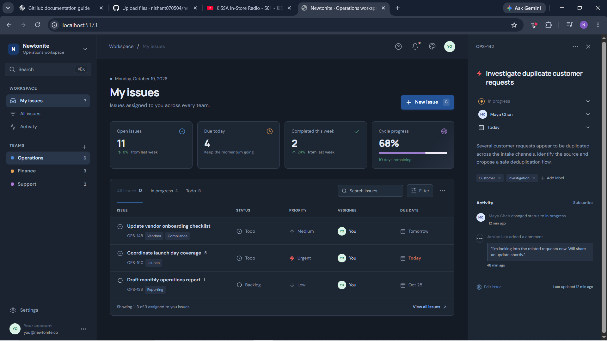
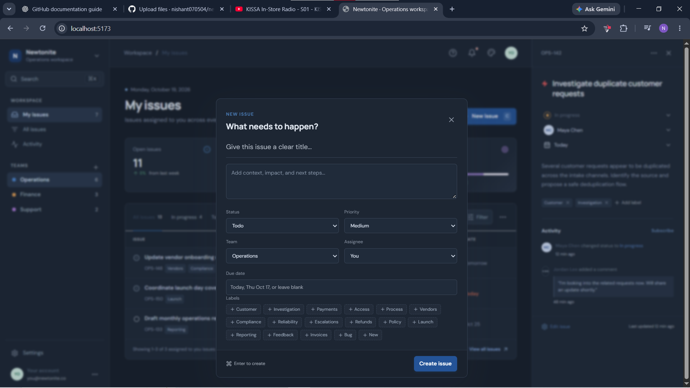

# Newtonite Operations Workspace

Newtonite is a focused operations workspace for creating, assigning, progressing, and reviewing operational issues. The project contains two parts:

- A polished React dashboard prototype for issue queues, teams, labels, filters, activity, editing, and appearance preferences.
- An Express API backed by Prisma and PostgreSQL with authentication, team-scoped authorization, issue workflows, optimistic concurrency, idempotent creation, claiming, and activity history.

The current repository is intentionally a small vertical slice. The API is the authoritative business-logic layer; the dashboard currently uses representative in-memory data and is not yet connected to the API.

## Current scope

## Screenshots

### Operations Dashboard



### Dashboard experience

- My issues, All issues, and Activity views
- Team navigation for Operations, Finance, and Support
- Search across issue titles, IDs, teams, and labels
- Status and label filters
- Paginated issue list
- Issue detail panel with status progression, labels, due date, owner, and activity
- Create and edit issue dialogs
- Add and remove labels from the issue detail panel
- Light and dark appearance modes with automatic time-based selection
- Responsive layout for desktop, tablet, and mobile widths

### API behaviour

- Account signup, login, and current-user lookup
- Eight-hour JWT access tokens
- Password hashing with bcrypt
- Team membership checks on every team-scoped issue operation
- Roles: `MEMBER`, `TEAM_LEAD`, and `ADMIN`
- Issue list scopes for all, assigned-to-me, and unassigned work
- Server-validated issue fields and workflow transitions
- Version-checked updates to prevent stale overwrites
- Atomic unassigned issue claiming
- Idempotency keys for safe repeated issue creation
- Activity records for issue creation, assignment, and updates
- Helmet, CORS, JSON size limits, and generic error responses

## Architecture

```text
React dashboard
      |
      | planned integration boundary
      v
Express API  ->  Prisma  ->  PostgreSQL
      |
      +-> JWT authentication
      +-> team membership and role checks
      +-> issue workflow and concurrency rules
      +-> issue activity history
```

The API is implemented in `server/app.ts`. The process entry point is `server/index.ts`. The relational model is defined in `prisma/schema.prisma`. The current API tests use a small in-memory Prisma-compatible test double so the critical behaviours can run without an external database.

## Requirements

- Node.js 20 or newer is recommended.
- PostgreSQL is required to run the API against the Prisma schema.
- A `DATABASE_URL` value is required by Prisma.
- A `JWT_SECRET` value is required by the API process.

Do not commit secrets. Local environment files are ignored by the repository.

## Install

```bash
npm install
```

Generate the Prisma client:

```bash
npm run db:generate
```

## Run the dashboard

```bash
npm run dev
```

The Vite dashboard opens through the development server. It currently displays local representative issue data and does not perform API requests.

## Run the API

Set the database connection and JWT secret in the environment, then run:

```bash
npm run api
```

The API listens on port `3001` by default. Set `PORT` to use another port.

Health check:

```text
GET /health
```

## API routes

### Authentication

| Method | Route | Auth | Purpose |
| --- | --- | --- | --- |
| POST | `/auth/signup` | No | Create a user and personal workspace |
| POST | `/auth/login` | No | Authenticate and receive a JWT |
| GET | `/auth/me` | Bearer token | Return the current user |

Signup and login accept an email and a password between 8 and 128 characters.

### Issues

All issue routes require `Authorization: Bearer <token>`.

| Method | Route | Purpose |
| --- | --- | --- |
| GET | `/issues?teamId=<uuid>` | List issues for a team |
| GET | `/issues?teamId=<uuid>&scope=mine` | List issues assigned to the current user |
| GET | `/issues?teamId=<uuid>&scope=unassigned` | List unassigned issues |
| POST | `/issues` | Create an issue |
| POST | `/issues/:id/claim` | Atomically claim an unassigned issue |
| PATCH | `/issues/:id` | Update an issue using its version |
| GET | `/issues/:id/activity` | Read the issue activity history |

Issue statuses are:

```text
BACKLOG -> TODO -> IN_PROGRESS -> DONE -> DEPLOYED
                 |         |
                 +-> BLOCKED <-+
```

The server rejects transitions that are not in the allowed transition map. An update must include the version returned by the server. If another request has already changed the issue, the API returns `409 Conflict` with the current issue.

## Verification

Run the complete API test suite:

```bash
npm test
```

Run frontend type checking and linting:

```bash
npm run typecheck
npm run lint
```

Run the production build:

```bash
npm run build
```

The current automated tests cover:

- Authentication and team-scoped access
- Repeated create requests with the same idempotency key
- Invalid workflow transitions
- Stale-version updates
- Single-winner issue claiming
- Activity records for create and claim operations

## Data model

The Prisma schema contains:

- `User`: credentials and ownership relationships
- `Team`: workspace boundary for issues
- `TeamMember`: user-to-team membership and role
- `Issue`: work item, workflow state, priority, version, assignee, and timestamps
- `IssueActivity`: append-only history for important changes
- `IdempotencyKey`: stored response for safe repeated operations

Indexes support team/status/update-time lists, assignee/status/update-time lists, team roles, and issue activity timelines.

## Known limitations

These are deliberate boundaries of the current submission:

- The React dashboard is not yet connected to the Express API.
- The browser dashboard uses in-memory representative data, so refreshing the page resets its visible changes.
- There is no migration or seed command in the repository yet.
- The API does not yet expose comments, label persistence, due-date mutation, or assignee reassignment endpoints.
- The API activity write after claim/update is separate from the guarded issue update; production hardening should move the mutation and its activity record into one database transaction.
- The API list endpoint currently returns a team-scoped collection without cursor pagination or server-side text search.
- There is no background worker or outbox implementation yet.
- There is no deployment configuration or hosted demo link in this repository.


